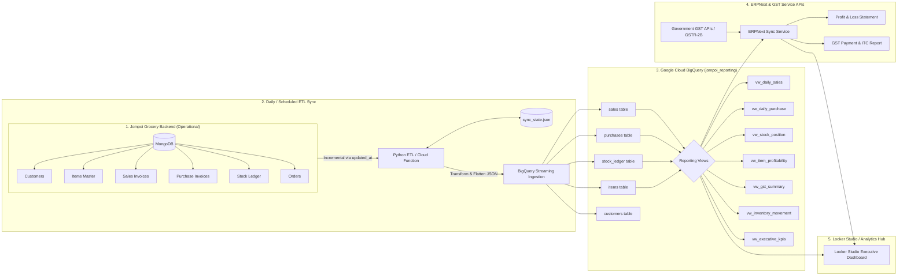

# Jompoi Online Grocery Data Pipeline & Analytics Hub

[](https://cloud.google.com/bigquery)
[](https://lookerstudio.google.com/)
[](#gst--itc-reconciliation-engine)
[-brightgreen.svg)](#running-tests)

A production-grade modern data warehousing, ETL synchronization, and business intelligence pipeline for **Jompoi Online Grocery**, converting operational transactional MongoDB collections into Google Cloud BigQuery reporting tables, automated analytical views, ERPNext financial synchronization, and GST Input Tax Credit (ITC) reconciliation.

---

## Architecture Overview



---

## Key Features

1. **Schema Flattening & Transformation Engine (`src/etl/transformer.py`)**:
   - Flattens deeply nested MongoDB documents (e.g. `customer: { name, city }` into `customer_name` and `customer_city`).
   - Normalizes MongoDB `_id` ObjectIds into string keys.
   - Standardizes ISO-8601 timestamps and calendar dates for BigQuery partitioning columns (`invoice_date`, `date`).

2. **Incremental State-Aware Synchronization (`src/etl/sync_manager.py`)**:
   - Tracks the highest processed `updated_at` timestamp in `sync_state.json`.
   - Queries only delta modifications (`{"updated_at": {"$gt": last_sync}}`), eliminating full-table scans.
   - Supports `--force-full` for initial backfills and `--dry-run` for offline validation.

3. **Production BigQuery Schema & Partitioned Tables (`bigquery_schemas/`)**:
   - `jompoi_reporting.sales`: Partitioned by `invoice_date`, clustered by `customer_city, item_code`.
   - `jompoi_reporting.purchases`: Partitioned by `invoice_date`, clustered by `vendor, item_code`.
   - `jompoi_reporting.stock_ledger`: Partitioned by `date`, clustered by `item_code`.
   - `jompoi_reporting.items`, `jompoi_reporting.customers`, and `jompoi_reporting.orders`.

4. **Curated SQL Reporting Views (`bigquery_views/`)**:
   - **`vw_daily_sales`**: Sales aggregation by day, item, and city.
   - **`vw_daily_purchase`**: Procurement volume and input tax by vendor.
   - **`vw_stock_position`**: Real-time stock on hand (`IN` minus `OUT`).
   - **`vw_item_profitability`**: Joins sales against average procurement costs to compute Cost of Goods Sold (COGS) and gross margin.
   - **`vw_gst_summary`**: Net GST liability calculator reconciling Output GST vs Input GST.
   - **`vw_inventory_movement`**: Complete stock audit trail.
   - **`vw_executive_kpis`**: High-level C-suite metrics.

5. **Government GST API & ITC Reconciliation Engine (`src/gst_engine/`)**:
   - Simulates Government GST Portal APIs (GSTR-2B matching).
   - Reconciles supplier-wise and document-wise Input Tax Credit (ITC).
   - Offsets eligible ITC against GSTR-1 Output Tax, calculating net cash tax payable and ITC carried forward.

6. **ERPNext P&L Statement Generator (`src/erp_integration/`)**:
   - Generates financial P&L Statements: Revenue, COGS, Gross Profit, Operating Expenses, and Net Profit.

7. **Interactive Executive Web Portal (`web/`)**:
   - Single-page application mirroring Looker Studio's executive layout.
   - Interactive charts for daily sales, category share, city breakdown, vendor distribution, and margins.
   - Live ETL inspector with raw MongoDB JSON vs BigQuery schema preview.

---

## Directory Structure

```text
Jumpoi/
├── .gitignore
├── .env.example                     # Environment configuration template
├── Dockerfile                       # Container deployment definition
├── docker-compose.yml               # MongoDB + Mongo Express + App stack
├── requirements.txt                 # Python dependencies
├── etl_sync.py                      # Production ETL synchronization CLI
├── seed_mongo.py                    # Database seeder for MongoDB
│
├── bigquery_schemas/
│   ├── create_tables.sql            # DDL for BigQuery tables with partitioning
│   └── insert_data.sql              # Replicated sample data inserts
│
├── bigquery_views/
│   ├── views.sql                    # Core reporting views (Step 4 of Blueprint)
│   └── advanced_views.sql           # Executive KPIs & valuation views
│
├── cloud_function/
│   ├── main.py                      # GCP Cloud Function entrypoint
│   └── requirements.txt             # Cloud Function dependencies
│
├── dummy_data/                      # Master raw JSON collections
│   ├── customers.json
│   ├── items.json
│   ├── orders.json
│   ├── purchase_invoice.json
│   ├── sales_invoice.json
│   └── stock_ledger.json
│
├── src/
│   ├── config.py                    # Configuration manager
│   ├── etl/
│   │   ├── transformer.py           # Document flattening & format conversions
│   │   ├── sync_manager.py          # Incremental sync state persistence
│   │   └── bq_loader.py             # BigQuery streaming insert loader
│   ├── gst_engine/
│   │   └── gst_reconciliation.py    # GSTR-1 vs GSTR-2B ITC reconciliation
│   ├── erp_integration/
│   │   └── erpnext_sync.py          # ERPNext tables sync & P&L generation
│   └── local_warehouse/
│       └── sqlite_bq_emulator.py    # Offline BigQuery SQLite emulator
│
├── web/                             # Executive Dashboard & Operations Hub
│   ├── index.html                   # Interactive Looker Studio style UI
│   ├── app.js                       # Chart.js visualization & data bindings
│   └── styles.css                   # Responsive dark theme
│
├── scripts/
│   ├── run_pipeline.py              # End-to-end pipeline runner
│   ├── serve_dashboard.py           # Local dashboard web server launcher
│   ├── deploy_cloud_function.ps1    # PowerShell GCP deployment script
│   └── deploy_cloud_function.sh     # Bash GCP deployment script
│
└── tests/                           # Automated test suite
    ├── test_transformer.py          # Document flattening tests
    ├── test_sync_manager.py         # State manager tests
    ├── test_gst_engine.py           # GST ITC tax math tests
    └── test_views_execution.py      # SQL views verification tests
```

---

## Quick Start

### 1. Installation
Clone the repository and install dependencies:
```bash
git clone https://github.com/theju1703/Jumpoi.git
cd Jumpoi
pip install -r requirements.txt
```

### 2. Run the Full Pipeline Workflow
Execute the end-to-end pipeline runner:
```bash
python scripts/run_pipeline.py
```
This executes:
1. Operational MongoDB seeding from `dummy_data/`
2. BigQuery schema transformation & materialized views calculation
3. Government GST Service API simulation & ITC reconciliation
4. ERPNext P&L statement generation

### 3. Launch the Interactive Dashboard
Open the Looker Studio style Executive Dashboard in your browser:
```bash
python scripts/serve_dashboard.py
```
Open [http://localhost:8080](http://localhost:8080) to view:
- **Executive Dashboard**: Revenue, Procurement, Gross Profit, Valuation, GST Liability
- **Sales Analytics**: Category breakdown, customer city distribution, item volumes
- **Purchases & Suppliers**: Vendor spend, cost rate vs selling rate
- **Inventory & Stock**: Current stock levels, status alerts, movement ledger
- **GST & ITC Portal**: GSTR-1 output vs GSTR-2B input credit reconciliation
- **ERPNext P&L**: Full operational Profit & Loss statement
- **ETL Inspector**: MongoDB nested JSON vs BigQuery flattened schema

### 4. Running the Incremental ETL Sync
To run the sync against your MongoDB and BigQuery instances:
```bash
# Real execution (requires GCP credentials and MongoDB running)
python etl_sync.py

# Offline dry-run preview (runs with dummy data, zero cloud costs)
python etl_sync.py --dry-run --force-full
```

---

## Running with Docker Compose

Spin up the entire stack (MongoDB, Mongo Express web UI, and Analytics Hub) in one command:
```bash
docker compose up -d
```
- **Analytics Hub**: [http://localhost:8080](http://localhost:8080)
- **Mongo Express UI**: [http://localhost:8081](http://localhost:8081)
- **MongoDB**: `localhost:27017`

---

## Running Tests

Execute the automated test suite with `pytest`:
```bash
pytest -v
```

All 6 test suites verify:
- Deeply nested customer flattening
- Date and timestamp conversions
- Incremental sync timestamp state management
- Input Tax Credit (ITC) utilization & excess carry forward calculations
- Offline BigQuery SQL views execution against SQLite emulator

---

## Deploying to Google Cloud Functions (2nd Gen)

Deploy the ETL function to Google Cloud Functions triggered via HTTP or Cloud Scheduler:

```bash
# Linux / macOS
chmod +x scripts/deploy_cloud_function.sh
./scripts/deploy_cloud_function.sh your-gcp-project-id us-central1

# Windows PowerShell
.\scripts\deploy_cloud_function.ps1 -ProjectId "your-gcp-project-id" -Region "us-central1"
```

Configure **Cloud Scheduler** to trigger the function daily or every 15 minutes:
```bash
gcloud scheduler jobs create http jompoi-daily-sync-job \
    --schedule="0 2 * * *" \
    --uri="https://us-central1-your-gcp-project-id.cloudfunctions.net/jompoi-mongo-bq-sync" \
    --http-method=GET
```

---

## Looker Studio Integration (Step 5 of Blueprint)

To connect BigQuery to Looker Studio:
1. Open [Looker Studio](https://lookerstudio.google.com/).
2. Click **Create** &rarr; **Data Source** &rarr; **BigQuery**.
3. Select your **GCP Project** &rarr; Dataset **`jompoi_reporting`**.
4. Choose the pre-built reporting view:
   - `vw_daily_sales`
   - `vw_daily_purchase`
   - `vw_stock_position`
   - `vw_item_profitability`
   - `vw_gst_summary`
   - `vw_executive_kpis`
5. Click **Connect** to automatically discover fields and start building visualizations.

---

## License
MIT License. Developed for Jompoi Online Grocery Data Infrastructure.
